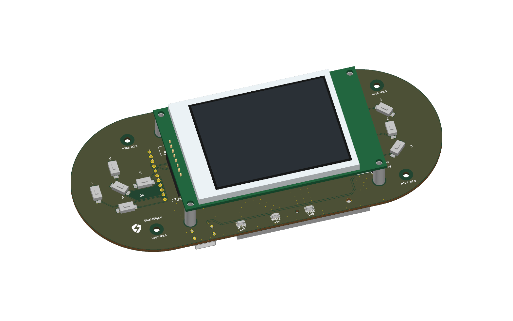
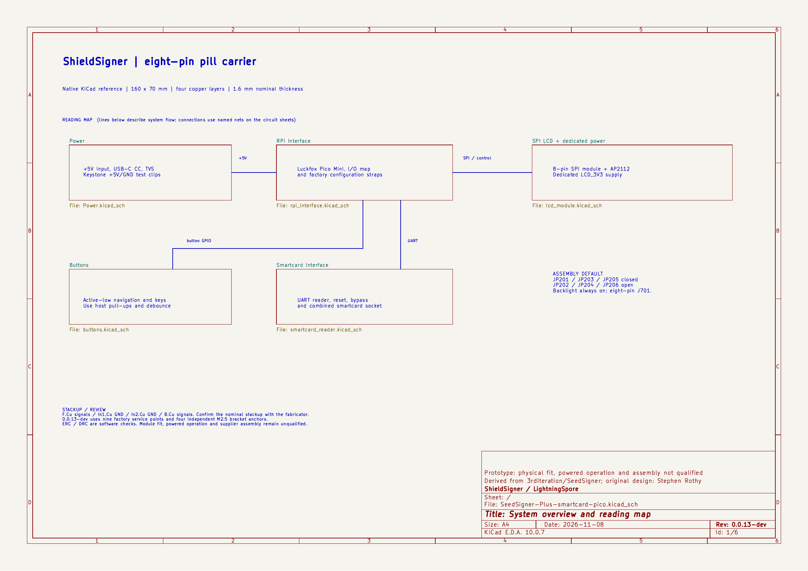
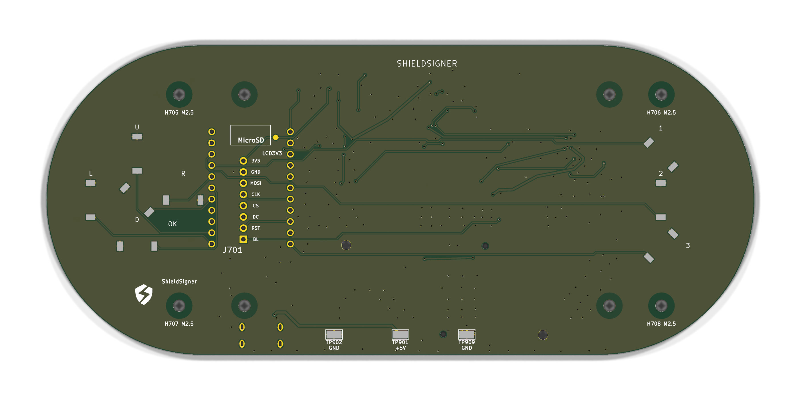
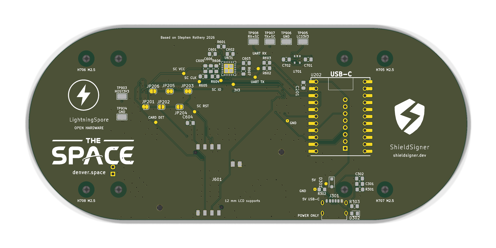

# ShieldSigner

An open-hardware smartcard signing device built around the Luckfox Pico Mini, a 2.8-inch SPI display, and physical controls.

[Hardware](hardware/README.md) · [Build guides](docs/README.md) · [Firmware](docs/FIRMWARE-ARTIFACTS.md) · [Website](https://shieldsigner.dev/) · [Contributing](CONTRIBUTING.md)



The **main PCB is the four-layer, eight-pin display carrier in [`kicad/`](kicad/)**. Open [the KiCad project](kicad/SeedSigner-Plus-smartcard-pico.kicad_pro) to edit its schematic or layout. Its previews, assembly data, sourcing information and review reports live in [`hardware/`](hardware/README.md).

## Current hardware

**0.0.13-dev** is a 160 × 70 mm capsule with two inner ground planes, an independently regulated display supply, eight buttons, a SEC1210 smartcard interface, and eight M2.5 mounting holes. The regulator and reader electronics are on the back. Nine factory-assembled Keystone loops provide service access, including a **GND — +5 V — GND** power clip row at 15 mm pitch.

The factory population is **44 SMT placements / 18 SKUs**, split **11 front / 33 back**. Modules, ordinary headers and mechanical hardware are fitted separately. See the [assembly guide](docs/MODULAR-ASSEMBLY.md) and [supplier-review instructions](hardware/manufacturing/README.md).

Native ERC, DRC, connectivity and schematic parity pass with zero violations or exclusions. This is a first-article development design: supplier sourcing/DFM approval and physical, thermal and powered bring-up remain open. [Order readiness](docs/PCB-ORDER-READINESS.md) tracks those limits. Older release ZIPs describe their tagged revisions; use the working tree's matched exports when reviewing 0.0.13-dev.

## Schematic and PCB views

The schematic starts with a system overview and a reading map for the six native sheets. Click a preview to open it at full resolution.

[](hardware/schematic-overview.png)

| Front PCB | Rear PCB |
|---|---|
| [](hardware/board-top.png) | [](hardware/board-bottom.png) |

[Schematic source](kicad/SeedSigner-Plus-smartcard-pico.kicad_sch) · [PCB source](kicad/SeedSigner-Plus-smartcard-pico.kicad_pcb) · [Rear assembly view](hardware/assembly-back.png)

## Open and check the board

Use [mise](https://mise.jdx.dev/) for project tasks. The project manages KiCad 10.0.7 separately from any installed KiCad 9; see [KiCad setup](KICAD.md).

```sh
mise install bun@1.2.21 uv@0.12.7
mise run setup
mise run kicad:open
mise run hardware:check
```

To regenerate review and supplier files:

```sh
mise run hardware:fab       # matched Gerbers, drills, BOM and CPL
mise run hardware:review    # schematic PDF, assembly renders, STEP and GLB
mise run hardware:package   # portable project and local review bundles
```

Outputs are written to `dist/lcd-module-2.8/`; this retained output name keeps existing tooling compatible. [`hardware/manufacturing/`](hardware/manufacturing/README.md) contains the tracked supplier data. The native project and local libraries remain the design authority.

## Build the device

| Task | Start here |
|---|---|
| Understand the circuit and pinout | [Hardware guide](docs/LCD-MODULE-VARIANT.md), [pinout and firmware compatibility](docs/PCB-SOFTWARE-COMPATIBILITY.md) |
| Source parts and assemble | [Factory kit](hardware/manufacturing/README.md), [assembly steps](docs/MODULAR-ASSEMBLY.md), [self-assembly option](docs/SELF-ASSEMBLY.md) |
| Find or build firmware | [Verified artifacts](docs/FIRMWARE-ARTIFACTS.md), [LVGL application](firmware/lvgl-app/README.md), [OS build](docs/OS-BUILD.md) |
| Print and fit the enclosure | [Enclosure guide](docs/ENCLOSURE.md), [CAD import and fit model](hardware/FIT-MODEL.md) |
| Review first-article behavior | [Display and button review](docs/DISPLAY-BUTTON-REVIEW.md), [bring-up](docs/BRINGUP.md) |
| Find component documentation | [Datasheets](datasheets/README.md) |

Use the **carrier firmware profile** before powering this PCB. The older bench profile drives two carrier button nets as display outputs. The [compatibility guide](docs/PCB-SOFTWARE-COMPATIBILITY.md) records the required 320 × 240 display configuration and GPIO mappings.

## Repository map

| Directory | Contents |
|---|---|
| [`kicad/`](kicad/) | Main native schematic, PCB, local libraries and 3D models |
| [`hardware/`](hardware/README.md) | Current-board previews, assembly files, sourcing and audits |
| [`datasheets/`](datasheets/README.md) | Component PDFs, provenance and BOM coverage |
| [`docs/`](docs/README.md) | Build, electrical, firmware and validation guides |
| [`firmware/`](firmware/) | Application, display, camera and image tooling |
| [`enclosure/`](enclosure/) | Printable enclosure and mechanical checks |
| [`scripts/`](scripts/) | Reproducible generation, export and verification tools |
| [`src/`](src/) | Experimental tscircuit projects and native reference preview |
| [`website/`](website/README.md) | Static knowledge site generated from an explicit content allowlist |
| [`variants/`](variants/README.md) | Historical FPC design and optional backlight experiment |
| [`reference/`](reference/) | Preserved upstream sources, research and attribution |

`mise run build`, `check` and `dev` use the main board's native reference preview. The independently routed tscircuit experiment has explicit `tscircuit:pill:*` tasks; it is separate from fabrication. See [port status](docs/PORT-STATUS.md).

## Attribution

Derived from [3rdIteration/SeedSigner](https://github.com/3rdIteration/seedsigner/tree/efdd1cfd14e80a076a7e1ae91e9f2270ecbcd44f/electronics/SeedSigner-Plus-smartcard-luckfoxpicozero), pinned at `efdd1cfd14e80a076a7e1ae91e9f2270ecbcd44f`. Original sources and provenance are preserved in [`reference/`](reference/provenance.json). The upstream [MIT license](LICENSE), local-library notices and supplier document attribution are retained.
