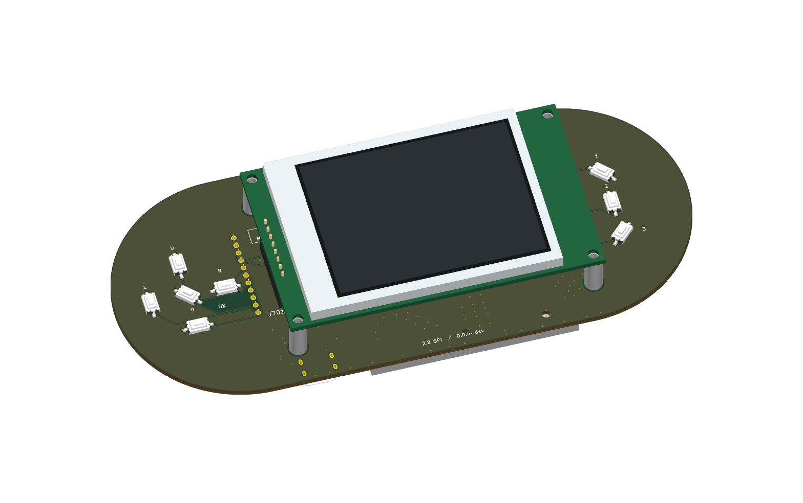

# ShieldSigner — modular Luckfox smartcard carrier



Native KiCad is the preferred editing workflow. This repository publishes the reviewed ShieldSigner carrier variant, tools and knowledge site. A separate experimental tscircuit port preserves the standard carrier for comparison.

## Eight-pin 2.8-inch pill build

Start with the [pill carrier guide](docs/LCD-MODULE-VARIANT.md) and [customer assembly steps](docs/MODULAR-ASSEMBLY.md). This **160×70 mm capsule** follows the eight-pin SPI module interface in the existing Luckfox design, with the larger 2.8-inch display between the controls. JLCPCB handles 35 SMT placements across 17 catalog lines. Customer soldering is ordinary headers: 30 carrier joints, plus up to 30 if both modules arrive bare.

The PCB uses a dedicated 3.3 V display regulator, supported display mounts and 22 local 3D models. Native ERC/DRC/connectivity/parity pass with zero exclusions. Open with `mise run variant:lcd:open`; build matched prototype quote files with `mise run variant:lcd:fab`. Physical fit, firmware/display behavior and powered bring-up remain unqualified.

The former 0.0.3-dev Pico-format display bay is superseded. Sections below also retain the separate standard FPC carrier and its experimental tscircuit port; do not mix their manufacturing files with the pill kit.

The [printed enclosure guide](docs/ENCLOSURE.md) includes the screw list, camera clamp, button mechanisms and first-fit checks. Inspect the [assembled and exploded models](https://www.shieldsigner.dev/guides/enclosure/) on the site. The [enclosure prototype release](https://github.com/lightningspore/shieldsigner-dev/releases/tag/enclosure-preview-0.0.3-dev) contains portable STL, SCAD and 3MF files for the 0.0.6-dev PCB. Run `mise run enclosure:verify` to regenerate and check the case.

The optional [DigiKey self-assembly guide](docs/SELF-ASSEMBLY.md) provides a separate purchase BOM for the same pill board. JLC remains the primary PCBA route.

## Standard FPC reference documentation

Read these in order:

1. [Electrical review](docs/ELECTRICAL-REVIEW.md): checked circuitry, corrected reset interpretation and open bench/assembly items.
2. [JLCPCB BOM plan](docs/BOM.md) and [sourcing table](docs/BOM-TABLE.md): 43 carrier placements, exact catalog identities and dated availability.
3. [Bring-up guide](docs/BRINGUP.md) and [results template](docs/BRINGUP-RESULTS.md): staged prototype measurements and tests.
4. [Smartcard choices](docs/SMARTCARDS.md): contact compatibility, SeedKeeper versus Satochip, DIY and conditional applets.

The [component guide](docs/COMPONENTS.md) covers all 53 PCB references and pad/net maps. [Hardware guide](docs/HARDWARE.md) explains the blocks; [port status](docs/PORT-STATUS.md) explains the experimental tscircuit limitations. Native KiCad is the preferred workflow.

## Standard FPC native workflow

See [KiCad setup, exports and remaining DRC work](KICAD.md). Use `mise run kicad:open` to open the complete native project, `mise run kicad:export` for review files and `mise run kicad:check` for ERC/DRC. The native schematic has zero ERC errors/warnings. The PCB has zero active DRC errors/warnings and zero unconnected/parity issues. Two documented courtyard exceptions apply only to mutually exclusive DNP mode straps; population checks enforce that assumption.

## Experimental tscircuit workflow

```sh
mise install bun@1.2.21 uv@0.12.7
mise run setup
mise run generate
mise run docs
mise run build
mise run check
mise run dev
```

`generate` requires `uv` and regenerates geometry from the current native KiCad PCB, recording its SHA-256. Builds/checks reject stale extracted data. `src/ShieldSignerPlus.tsx` defines the native board. `scripts/build.tsx` verifies every physical pad against the reference before attaching the original tracks, vias, and filled copper. `src/index.tsx` exposes the native components for tscircuit preview. `mise run dev` regenerates/builds and previews routed circuit JSON on http://localhost:3020. After changing KiCad or TSX, run generate/build again to refresh that output. `mise run dev:source` previews editable TSX without imported copper on port 3022.

Outputs in `dist/`: circuit JSON, top/bottom PCB SVGs, schematic SVG, and BOM JSON. The schematic is a generated connectivity view, not a reproduction of the original schematic sheet arrangement. Components use generic chip symbols with original values and pin aliases.

## Standard FPC hardware reference

Pinned upstream commit: `efdd1cfd14e80a076a7e1ae91e9f2270ecbcd44f` in [3rdIteration/seedsigner](https://github.com/3rdIteration/seedsigner/tree/efdd1cfd14e80a076a7e1ae91e9f2270ecbcd44f/electronics/SeedSigner-Plus-smartcard-luckfoxpicozero). Original board, hierarchical schematics, README, license and provenance are in `reference/`.

The port contains 53 components, 86 named nets (including unconnected physical pin groups), 479 tracks, 314 vias, and 33 filled copper polygons. It includes the SEC1210 smartcard interface, combined SIM/full-size card socket, USB-C power, buttons, and 40-pin 2.8-inch ST7789 LCD interface. Use the upstream BOM and assembly instructions to select exact parts. The Luckfox Pico mounts microSD side upward, USB end toward the edge; insulate protruding pins beneath the LCD and follow the reference jumper defaults.

The [OS compilation guide](docs/OS-BUILD.md) records pinned inputs, the Proxmox builder setup, build commands, monitoring and artifact retrieval. See [the bring-up guide](docs/BRINGUP.md) for hardware and first boot. Firmware selection and secure boot are separate from the PCB port. B13's signed Mini SD image uses a public development key; signing alone does not enable secure boot. Do not fuse a device as part of PCB setup.

## Validation and limitations

The build writes `dist/validation-report.json` with preserved renderer warnings and the exact validation scope. The port checks physical land coordinates/polygons and preserves original copper rather than invoking a new autorouter. Roundrects and board arcs are polygon approximations; a 0.02 mm tolerance closes tiny source outline gaps. Original silkscreen, paste-only exposed-pad stencil subdivisions, full manufacturing stackup and fabrication outputs have not been migrated. Two known component body bounding-box warnings (SW503 and U202 near the module notch) are excluded from compiled output; actual pad geometry is still checked. This is a reproducible editable port and preview, not a manufacturing sign-off. Review the original KiCad design and run manufacturing DRC before ordering.


## Public documentation website

[shieldsigner.dev](https://shieldsigner.dev/) presents the hardware, smartcards, firmware and build guides. The [static website implementation and deployment guide](website/README.md) follows the SeedPills Caddy pattern. Public HTML and assets are generated from these docs; private ingestion data is excluded.

## License and provenance

Derived from 3rdIteration/SeedSigner at the pinned revision in [reference/provenance.json](reference/provenance.json). The upstream MIT notice is retained in [LICENSE](LICENSE). Supplier PDFs remain their publishers’ documents; footprint-library notices are retained in place. This is a development variant, not a tested production signer.

## Public repository

Canonical source: [lightningspore/shieldsigner-dev](https://github.com/lightningspore/shieldsigner-dev). See the [build overview](docs/BUILD-OVERVIEW.md) for the broader module/camera/case/firmware workflow. The [0.0.6-dev pill preview](https://github.com/lightningspore/shieldsigner-dev/releases/tag/pill-preview-0.0.6-dev) contains the current native project, schematic, matched quote kit and 3D exports. The older workflow preview remains a separate standard FPC reference. These are prototype review files, not physically qualified production hardware.

## Build and use workflows

The public site now starts with six tasks: [PCB order](https://shieldsigner.dev/build/pcb/), [parts](https://shieldsigner.dev/build/parts/), [compile](https://shieldsigner.dev/build/compile/), [flash](https://shieldsigner.dev/build/flash/), [SeedSigner use](https://shieldsigner.dev/build/use/) and [smartcards](https://shieldsigner.dev/build/cards/). The site is **0.0.8-dev**, with its Git revision visible. Passives show explicit units and catalog ratings. For the standard FPC reference, `mise run bom:check` validates its 28 fitted passive values. The pill manufacturing gate validates its own fitted passives against its catalog. C603/C604 purchase identities are now the 1 µF C28323 parts, superseding the initial preview’s incorrect 100 nF metadata.

Revision **0.0.6-dev** replaces the eight XKB switches with C&K PTS636SK25SMTRLFS and the SHOUHAN USB-C with GCT USB4125-GF-A-0190, using new manufacturer lands and exact shared JLC/DigiKey MPNs. Use its matched BOM/CPL and Gerbers together. The [mechanical review](docs/MECHANICAL-SUBSTITUTIONS.md) records the baseline comparison; [self-assembly documentation](docs/SELF-ASSEMBLY.md) explains sourcing and measured-height plungers.
