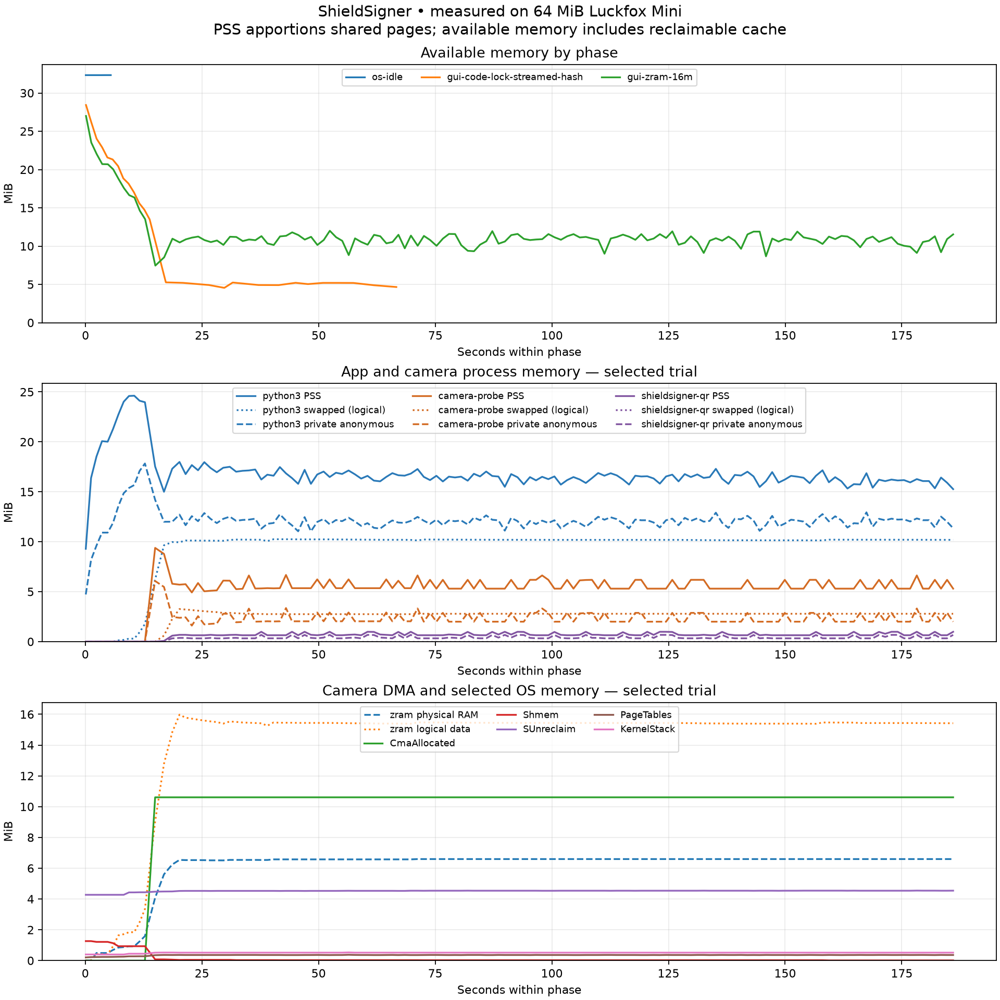
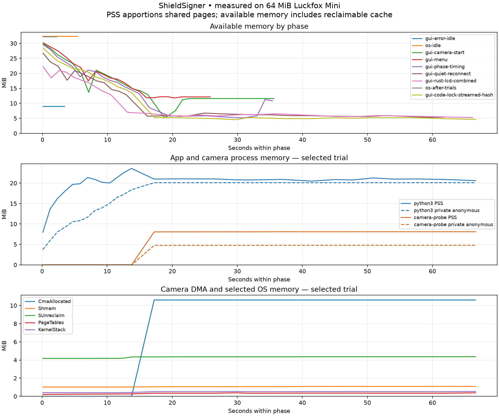
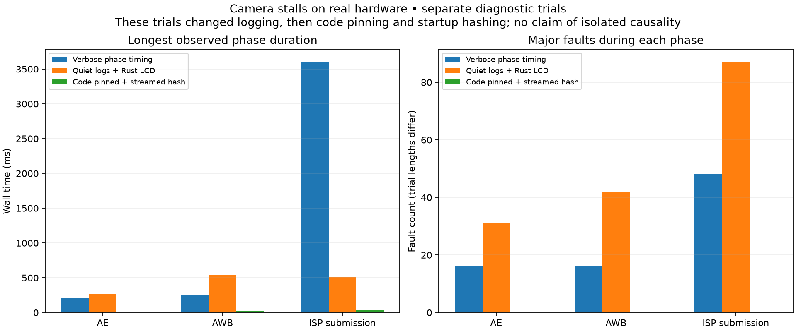
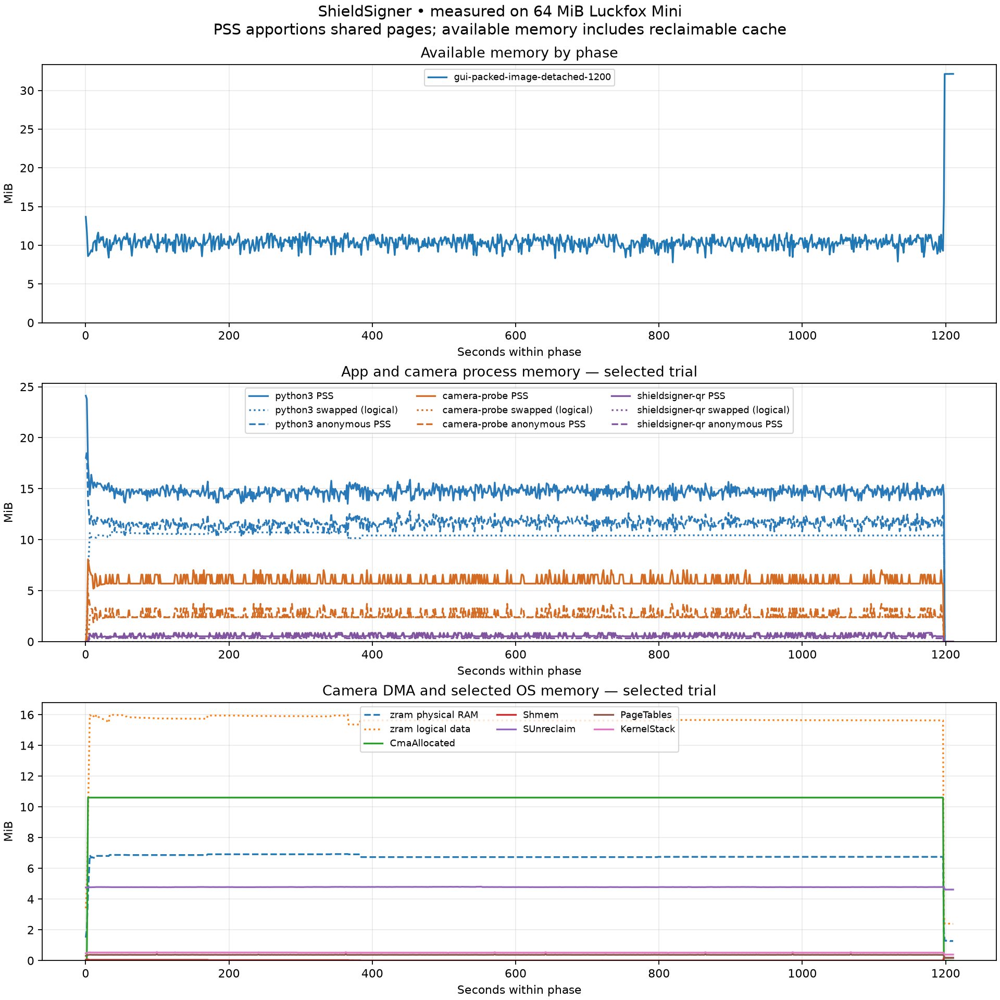

# Camera and app memory measurements

The ten-minute real ScanView soak passed with 8,851 camera frames, 2,968 renderer calls and 3,503 native QR decoder calls: zero errors or reconnects, followed by clean owner/DMA teardown. This run used native camera SHA `102b86c9…` and final LCD SHA `a3d81514…`. A later one-minute test of native `2957852a…` (final metrics placement only) also passed with the optional wallet/smartcard/settings UI modules preloaded: 746 frames, 261 renderer calls, 294 decoder calls, no reconnects or errors. The test preloaded module code and supplied no seed or transaction payload.

The first three-minute real ScanView trial with compressed RAM swap and the PyO3 LCD driver completed 2,544 camera frames and 843 renderer calls, with zero reader/LCD errors. One startup transport reconnect recovered. The native owner stopped without cleanup errors and `CmaAllocated` returned to zero. Three subsequent fresh one-minute launches also passed: 732/756/763 camera frames, 245/267/271 renderer calls, and 290/301/305 native QR decoder calls. All three had zero reconnects and zero reader, renderer or decoder errors. Native owners stopped cleanly and DMA allocations returned to zero. Physical QR decoding, user-driven Back navigation, visual confirmation and a persistent image are still being qualified.



In the stable 30–170 second portion, available memory ranged from 8.67 to 12.00 MiB. App resident PSS ranged from 15.33 to 17.50 MiB, camera PSS from 5.25 to 6.68 MiB, and the native QR worker from 0.64 to 0.98 MiB. Approximately 15.5 MiB of logical swapped data occupied at most 6.59 MiB of compressed backing RAM. These are separate accounting views, not quantities to add together. The original logical heap contents remain present in compressed RAM; lower resident PSS does not mean features or objects were discarded.

The diagnostic configuration uses 16 MiB logical zram swap, LZO compression and an 8 MiB backing-memory limit. It never writes swap to the SD card. Matching kernel modules were built without changing the kernel cache or rebuilding Linux; provenance and compatibility checks are in `reverse-engineering/rkaiq/zram-module-build-receipt.json`. This setup is temporary on the current boot until packaged into an image.


A later 23-minute live preview also stopped cleanly: 20,527 camera frames, 7,395 renderer calls and 8,153 QR decoder calls, with zero errors/reconnects. Result: `reverse-engineering/rkaiq/memory/gui-zram-23min-result.json`.

The Rust LCD's packed bytes were compared on the physical ARM board against the original Pillow `BGR;16` conversion plus byteswap across 256 RGB samples covering every value in each channel. The results were identical; this check opened no GPIO/SPI device. The ordinary launcher also loaded the Rust LCD without the benchmark's import-path setup and reached its startup interstitials without logged import/display errors. Its development-build acknowledgement still needs a physical button press.

Initial measurements before compressed swap follow.

Measured 2026-10-29 on the physical 64 MiB Luckfox Pico Mini, CMA12 development image, with the confirmed fork display/button map. These are debugging measurements, not a reliability qualification.



| Measurement | Observed |
|---|---:|
| Physical RAM | 64 MiB |
| Linux MemTotal | 44.95 MiB |
| Camera CMA reservation | 12 MiB |
| OS idle MemAvailable, app/camera stopped | 32.33 MiB |
| Minimum MemAvailable during sampled GUI camera startup | 5.10 MiB |
| Peak app PSS during startup trial | 26.32 MiB |
| Peak Rust camera PSS during startup trial | 8.63 MiB |
| Peak camera DMA allocation | 10.61 MiB |
| Swap | None |

The peaks are sampled, not exact allocation high-water marks, and need not occur simultaneously. A one-second host-side ADB sampler reads `/proc/meminfo` and selected processes' `/proc/PID/smaps_rollup`. It does not start Python on the target or record images/QR contents. Sampling itself has some overhead and process reads are not atomic.

PSS apportions shared resident pages; RSS counts shared pages in each process. Private anonymous memory mostly contains Python/Rust heaps and stacks; file-backed pages can be reclaimed and read again. `MemAvailable` estimates usable headroom including reclaimable pages, so `MemFree` alone understates it. CMA is reported separately: it is reserved outside this kernel's ordinary `MemTotal`; do not add process memory, DMA memory, cache and reservations without accounting for overlaps. On this kernel idle CMA is released by the DMA heap, and `CmaFree: 0` does not mean all camera memory is actively allocated; use `CmaAllocated`.

The roughly 7 MiB difference between physical RAM, Linux MemTotal, and the CMA reservation includes kernel/platform reservations; it has not been fully attributed. Idle OS's unavailable portion of MemTotal includes services, kernel allocations and estimation effects, rather than a single process called “the OS.”

## Reproduce the chart

From the repository root:

```sh
mise run camera:memory:collect \
  --label gui-camera-start --seconds 60 \
  --output dist/reverse-engineering/memory/measurements.jsonl
mise run camera:memory:chart \
  dist/reverse-engineering/memory/measurements.jsonl \
  dist/reverse-engineering/memory/memory-usage.png --phase gui-camera-start
```

The collector appends samples. Use a new label for each trial and a new output file for a separate experiment. The chart's lower panels display the last phase. The initial sanitized measurements and rendered chart are saved under `reverse-engineering/rkaiq/memory/`. New experiment output lives under ignored `dist/`; no private captures are committed.

## Failure interpretation

Earlier kernel logs proved app OOM kills. Memory is therefore a demonstrated reliability issue, but it does not explain every failure.

The fresh sampled startup trial ended with a native socket write deadline at frame 0. Native control metrics had queue high-water 4, no rejected events, and a maximum parameter-slot wait below 1 ms. The owner then acknowledged cancellation and cleaned up successfully. Python treated EOF as a fatal reader failure and terminated the owner. This trial does not support attributing its failure to an AE event overflow or parameter-pool stall.

A separate earlier trial did show one approximately six-second statistics-handling stall, queue overflow and a subsequent parameter-pool timeout. Phase timing is now implemented. A controlled instrumented repeat measured a 3.53-second logging span using only 1.62 ms of thread CPU and incurring five major faults. The overlapping ISP preparation span took 3.60 seconds. This localizes the dominant observed stall to logging rather than ISP arithmetic; blocking output, paging and scheduling remain possible contributors. Production per-frame logging is being removed from the critical path while explicit full diagnostic mode remains available. Full GUI Scan remains unresolved until repeated real hardware sessions pass.

## Startup allocation removed

`NativeQrReader` previously called `read_bytes()` on the approximately 8 MiB native QR worker before hashing it. It now streams 64 KiB chunks. Two fresh Python3.12 processes on the board produced the same worker SHA-256. Peak process RSS for the isolated hashing check was 18,088 KiB with a whole-file read and 10,076 KiB with chunked hashing: a 7.82 MiB reduction in that check's transient peak. This is not a claim that steady-state app memory falls by that amount.

## Combined LCD/camera trial

The first combined trial used the final PyO3 LCD extension, normal animated loader, quiet native runtime logs and bounded transport reconnects. It completed 39 renderer calls but received only one camera frame, made three reconnects, and eventually failed after about 50 seconds with native parameter-pool timeout and event overflow. It did not qualify as a working preview. Phase timing showed sub-millisecond-to-few-millisecond CPU work interrupted by hundreds of milliseconds of wall time and repeated major faults. Read-only native code pinning is being evaluated as a bounded experiment; reducing Python's memory footprint remains necessary.

## Bounded code-pinning trial

The opt-in native code-pinning trial successfully locked 1,560,576 bytes (1.49 MiB) of the executable's own read-only mappings. The parent explicitly permitted a 4 MiB MEMLOCK limit for this process tree; the native implementation never raises the hard limit and caps selection at 4 MiB. Heap, DMA buffers, other libraries and writable mappings remain unpinned. Pinning remains experimental and is disabled by default.

The trial processed 664 SOF events and 442 statistics events, with queue high-water 1 and zero rejected events. Measured AE, AWB and ISP phases incurred zero major faults, compared with repeated faults and multi-second queue delays in previous trials. No kernel/ISP timeout or queue capacity was relaxed. Startup hashing changed in this trial too, and cache conditions/trial durations differ; this is useful evidence, not an isolated causal benchmark or a GUI reliability pass. The GUI still received zero full frames and exhausted transport retries.



Sanitized per-phase measurements are in `reverse-engineering/rkaiq/memory/camera-phase-timings.json`; regenerate the chart with `scripts/camera-memory/chart-stalls.py` in the same pinned matplotlib environment as the main chart. Timings of nested spans overlap and must not be added together.

A fresh headless run with the same current native binary and Python transport received 295 complete NV12 frames in 20.08 seconds, consumed 118 at a 6 fps consumer target, and made zero reconnects. This separates the remaining GUI failure from a generally broken native transport. The full GUI prewarm experiment still stalled and did not pass. Thread dumps and lazy import work are continuing.

## Failure recovery

A separate on-hardware API test intentionally SIGKILLed the native camera owner after receiving real frames. The Camera API propagated the failure, detached the failed stream in `finally`, reopened a new owner, received 11 fresh frames, and stopped cleanly. The test saved no images or decoded payloads. This verifies API recovery from an owner crash, rather than claiming a user navigated Back from the error screen.

Result: `reverse-engineering/rkaiq/memory/camera-fault-recovery.json`. The target-side test is `firmware/bench-profiles/camera-fault-recovery-check.py`; run only when other camera/app owners are stopped, using the reviewed runtime and memory setup.

## Image and startup qualification

The persistent zram kernel probe built successfully and passed all 190 ARM camera ABI assertions. A second probe also verified the explicit base-fork device tree disables UART2, freeing GPIO42/43 for buttons. The carrier default keeps its serial smartcard interface; base-fork alone holds PCSC autostart. These are compiled configuration checks, not a cold boot of the new image.

A startup lifecycle fix keeps expensive executable prefaulting after native shutdown handlers and the managed READY acknowledgement are armed, before any camera graph access. The ARM black-box test deliberately used an insufficient 64 KiB hard MEMLOCK limit and invalid graph paths: READY was acknowledged, pinning failed explicitly, the process exited, and no camera DMA was allocated. Result: `reverse-engineering/rkaiq/memory/code-lock-readiness-result.json`. This prevents code-page loading from consuming the short readiness-handshake budget; it does not increase that budget.

Runtime sources are now versioned `0.0.39-dev`; earlier successful soaks retain their original binary hashes. The frozen `0.0.38-dev` release kit and historical hardware proofs have not been rewritten as new-image qualification.

The latest `0.0.39-dev` native binary (`3da849d8…`, including the READY-before-prefault fix) also passed a fresh 60-second real GUI/Rust LCD hardware run: 740 frames, 242 successful renders and 294 QR calls, no reader/render/decoder errors, one recovered startup reconnect, and no remaining camera/QR owner or allocated camera DMA after duration cleanup. This used the existing image with runtime overlays, not the new image. No optical QR was decoded. Result: `reverse-engineering/rkaiq/memory/gui-latest-native-60-result.json`.


The `2663ac8` image build completed and passed packed readback plus ARM Python/LCD QEMU checks. Local artifacts are under `dist/os/verified/mini-0.0.39-2663ac8/` (ignored build outputs). The raw image SHA256 is `337f99eb707614bd2b5e169adeb3592417ef1bc9f640b208661cfd060c250f97`; the compressed image SHA256 is `3a8e118f0173fbe15d6d264ed4c1a5540dd32d80b26c4dd68a06adeca6ab9241`. Both were verified after transfer. Public packed report: `reverse-engineering/rkaiq/memory/image-0.0.39-2663ac8-packed-verification.json`.

A read-only mount of that exact image's SquashFS supplied the app, camera runtime and newly built LCD extension for a real-board 60-second GUI test: 709 frames, 231 renders, 285 QR calls, zero errors/reconnects and clean owner/DMA teardown. The LCD extension hash is `77d2fb008e5df1f38c169d4f9df37174037d58faf0c05d7fa66d95ee03901ff3`. The existing kernel, Python runtime and bench zram setup were retained, so this does not qualify a cold boot. Result: `reverse-engineering/rkaiq/memory/gui-packed-image-60-result.json`.


## Packaged-runtime 20-minute soak



The detached 1,200-second run completed with exit status 0: **17,811 camera frames, 5,929 renders and 7,042 QR calls; zero reader/render/decoder errors and zero reconnects**. Duration cleanup completed without errors; camera/QR owners exited and allocated camera DMA returned to zero. An earlier desktop-session-bound attempt was interrupted at about 210 seconds and is excluded from this result.

Across 871 complete steady camera-phase samples, available RAM was **7.79–11.70 MiB (median 10.36 MiB)**. Median resident PSS was **14.73 MiB app, 5.69 MiB camera native, and 0.52 MiB QR worker**. Camera DMA was 10.61 MiB; compressed-swap allocation was **6.73–6.93 MiB**. PSS, DMA and swap are separate measurements; logical swapped bytes are not additional physical RAM. The trace shows no sustained upward resident-memory trend during this run, not a proof against every possible leak.

Public counters/provenance: `reverse-engineering/rkaiq/memory/gui-packed-image-1200-result.json`. Reduced metadata-only samples: `gui-packed-image-1200-measurements.jsonl` in that directory. Regenerate using `mise run camera:memory:chart reverse-engineering/rkaiq/memory/gui-packed-image-1200-measurements.jsonl reverse-engineering/rkaiq/memory/memory-packed-image-1200.png`.

This tested the exact packaged app/camera/QR/LCD files from a read-only compressed rootfs mount, with the existing board kernel/Python/bench zram. It did not flash or cold-boot the new image, decode an optical QR, or qualify physical Back/button navigation. Those acceptance checks remain pending.
