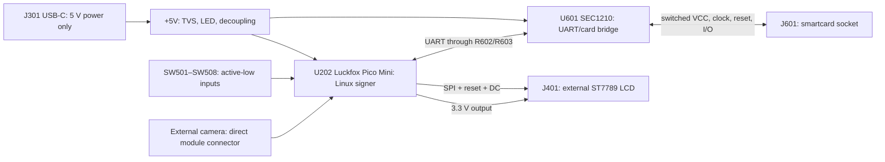

# How the ShieldSigner Luckfox carrier works

This is an explanation of the pinned upstream circuit, not a new electrical qualification. The initial tscircuit port lost assembly and drawing semantics, so its appearance was less complete than the native KiCad design. Native KiCad is now the preferred editing workflow in `../kicad/`. The complete [component guide](COMPONENTS.md) explains all 53 PCB references and gives actual pad-to-net mappings.

## Read this design in blocks

The carrier connects existing modules. It does not contain a standalone RV1103, an LCD controller IC, or a cryptographic secure element. U202 is a purchased Luckfox module. The ST7789 is on the purchased display. A Satochip/SeedKeeper card, when used, supplies its own secure storage and application. U601 is a communications bridge, not the security boundary.

## Host selection and power

The Pico Mini offers the Linux environment, MIPI camera connection, SPI display interface, UART reader interface and GPIO buttons used by the fork. That is the functional reason it fits this design. We inherited this selection; no new comparison of module cost, power or longevity has been performed.

The official [Luckfox RV1103 board overview](https://wiki.luckfox.com/Luckfox-Pico/Luckfox-Pico-RV1103/) identifies Mini A/B as RV1103 boards. The bundled README instead calls the host RV1106; treat that as a source inconsistency. Match the actual module/storage variant and firmware image. GPIO names below come from the bundled symbol, not a separately verified manufacturer's physical pinout.

J301 supplies 5 V. R301/R302 are separate USB-C CC sink pull-downs. D301 suppresses transients; it is not a voltage regulator. D302/R303 indicate the presence of 5 V. C301/C302 decouple power entry; C201 provides local host bulk capacitance. U202 pin 3 supplies the carrier 3.3 V rail. There is no separately drawn 3.3 V regulator on this carrier and no documented aggregate LCD/module GPIO-rail current budget here.

J302 is an optional direct 5 V input, **DNP in the reference assembly**. There is no battery charger, USB-PD negotiation or demonstrated input isolation. Do not interpret multiple connectors as permission to connect multiple independent power sources.

| U202 original pin | Bundled GPIO / function | Board use |
|---|---|---|
| 1 | VBUS | +5V input |
| 2, 21 | GND | Ground |
| 3 | 3V3(OUT) | Carrier +3.3V output |
| 4 | GPIO1_B2 | UART_TX to U601 RXD via R602 |
| 5 | GPIO1_B3 | UART_RX from U601 TXD via R603 |
| 6 | SPI0_CS0 / GPIO1_C0 | CS or backlight, selected by jumpers |
| 7 | SPI0_CLK / GPIO1_C1 | LCD_SCLK |
| 8 | SPI0_MOSI / GPIO1_C2 | LCD_MOSI |
| 9 | SPI0_MISO / GPIO1_C3 | LCD_RST; used as GPIO, not SPI MISO |
| 10 | GPIO1_C4 | LCD_DC |
| 11 | GPIO1_C5 | Key3 |
| 12 | GPIO1_D0 | JoystickLeft |
| 13 | GPIO1_D1 | JoystickUp |
| 14, 15 | GPIO1_D2, GPIO1_D3 | I2C-SDA/SCL; no external PCB peripheral attached |
| 16 | GPIO1_C6 | JoystickPress |
| 17 | GPIO1_C7 | JoystickDown |
| 18 | GPIO0_A4 | JoystickRight |
| 19, 20 | GPIO4_C0, GPIO4_C1 | Key1 / Key2 |
| 22 | 1V8(OUT) | Intentionally unconnected |

Pin mux matters: a pin labelled SPI MISO can be repurposed as reset, but firmware must configure it as the intended GPIO. The `_d`, `_u`, `_z` suffixes in the custom symbol are annotations, not proof of runtime pull configuration. The button block has no external pull-ups. The firmware must establish input pulls and debounce; pressing a switch grounds its input.

## LCD and backlight

J401 connects the reference 2.8-inch 240×320 ST7789 display. The PCB maps pin 9 to chip select, 10 to clock, 11 to data/command, 13 to MOSI and 15 to reset. Parallel-data, touch and MISO contacts are not used. R410 pulls the unused parallel read strobe high. C401 decouples LCD logic power.

IM2/IM1/IM0 select the interface at reset. The reference configuration is **1/1/0**, called four-line SPI in the upstream schematic note. R403 pulls IM1 high, R409 pulls IM0 low and IM2 is directly high. **R404 and R408 must remain DNP.** Populating both members of either strap pair shorts +3.3V to ground.

Q401 switches the backlight on its ground side. R401 is a gate resistor, R402 a gate pull-down. R405/R406/R407 separately limit three LED-cathode branches. The 47 Ω values depend on the reference LCD's LEDs and supply; this is a resistor-limited circuit, not a constant-current driver. The generic MOSFET and LED symbols are not exact purchase part numbers; upstream supplier identifiers are preserved in the component guide and BOM for qualification.

There is an unresolved source documentation discrepancy: `screen.kicad_sch` says its FPC pinout is reversed from the display datasheet, while `readme.md` says this board's pinout is not reversed. The documented pad/net map is what the PCB contains. Check the actual LCD drawing, contact face and cable orientation before assembly; do not resolve that discrepancy by assumption.

## Configuration

| Pair / strap | Reference default | Meaning |
|---|---|---|
| JP201 / JP202 | JP201 closed; JP202 open | Backlight control held at +3.3V |
| JP203 / JP204 | JP203 closed; JP204 open | Module pin 6 used for chip select |
| JP205 / JP206 | JP205 closed; JP206 open | LCD chip select follows the selected MCU CS signal |
| R403 / R404 | R403 fitted; R404 DNP | IM1 high |
| R408 / R409 | R408 DNP; R409 fitted | IM0 low |

Never close both solder jumpers in a pair. The default signal path is **U202 pad 6 → JP203 → MCU_SPI_CS → JP205 → RPI_SPI_CS → J401 pad 9**. The default light path is **+3.3V → JP201 → RPI_BACKLIGHT → R401 → Q401 gate**. Names such as MCU_SPI_CS need not touch a module pad directly because jumpers join them.

A possible alternative uses JP202/JP204/JP206 closed and JP201/JP203/JP205 open: module pin 6 controls the backlight and LCD CS is grounded. This requires firmware/pinmux support and a display driver that supports that CS arrangement; it is not the default assembly or a tested change in this project.

The source marks three jumpers bridged. Their physical copper bridges and connection semantics were not migrated into the initial tscircuit implementation. Keeping two pads and labelling a generic chip “Bridged” does not actually join the nets. That is why the tscircuit net view alone cannot demonstrate a working CS path. Use native KiCad for the authoritative bridge geometry and inspect assembly settings.

## Smartcard circuit

The [Microchip SEC1210 datasheet](https://www.microchip.com/content/dam/mchp/documents/UNG/ProductDocuments/DataSheets/00001561D.pdf) describes a UART/USB smartcard bridge. This board uses UART and one card channel. The upstream selection avoids making Linux GPIO reproduce smartcard timing. It still requires the correct bridge firmware variant and host driver; the generic controller family name is not sufficient to qualify a replacement.

U601 receives +5V with C602 local decoupling. C603 serves the distinct SEC1210_VDD33 node; do not tie it to the Luckfox 3.3 V output. The native variant updates C603/C604 from 100 nF to 1 µF to match datasheet table 6-4 notes 6-2/6-3; see [variant changes](../kicad/CHANGELOG.md). R601/C601 bias the bridge reset at startup (nominal RC time constant 10 ms, not a guaranteed reset duration). R607 biases TEST low. R602/R603 are UART series resistors, not voltage translators. A serial console on the same UART competes with the reader.

At J601, C1 is switched card VCC, C2 reset, C3 clock, C5 ground and C7 bidirectional I/O. The PCB also joins C6 to card VCC; C4/C8 are unconnected at the socket. R604/C606 condition the clock, C605 loads fast reset edges, R605/R606 weakly bias reset and I/O, and C604 decouples switched card power. These conditioning explanations are inferred from topology; source notes do not prove how each value was calculated.

The [Amphenol socket specification](https://www.amphenol-cs.com/product/7312p0225a13lf.html) confirms eight contacts, SMT mounting and a normally-open detect switch. COM goes to ground and NO to the bridge presence input. The upstream calls it a full-size/SIM combo; verify the mechanical arrangement for your exact card. Card VCC can be off until activation, so an idle zero-volt measurement is not by itself a failure.

## Reading errors and incomplete views

See [PORT-STATUS.md](PORT-STATUS.md). “Build/check pass” means the implemented geometry/count/schema checks passed. It does **not** mean KiCad ERC/DRC, a whole-board power budget, timing margins, signal integrity or assembly were qualified. The original claims of a complete board preview were too broad.

## Bring-up and diagnosis

1. Inspect the native PCB and assembly flags. Confirm R404/R408/J302 are absent, jumper defaults are correct, and solder does not short the LCD mode straps or fine-pitch FPC pads.
2. Before power, inspect +5V-to-ground and +3.3V-to-ground continuity for unexpected shorts. A charging capacitor can briefly affect a meter reading; resistance readings alone do not qualify a board.
3. Power with one regulated 5 V source and current limiting. Verify +5V and the module's +3.3V output before attaching the LCD/card. No production current limit has been established here.
4. Boot the exact module/storage-compatible firmware. Verify that it configures the documented button inputs and the reset/DC GPIOs.
5. If the LCD is blank, first distinguish no backlight from no pixel data. Check jumper paths, Q401 gate/drain, FPC orientation, mode straps, reset and SPI activity. Brightness does not prove that SPI works.
6. If buttons float or appear stuck, check pinmux/pulls and confirm that each switch grounds only its own input when pressed.
7. If the reader is absent, check bridge supply/reset, correct UART driver and baud configuration, and a disabled competing console. If the reader exists but no card is detected, inspect J601's COM/NO switch and card insertion before changing firmware.

Module headers under the LCD can short the display housing to supply pins; the upstream calls for insulation. The camera connects directly to the Pico Mini, so a missing camera connector on the carrier is intentional. Match enclosure variant to soldered versus header-mounted host.

## Evidence and maintenance

Electrical topology, values, DNP flags and actual land mappings are taken from commit `efdd1cfd14e80a076a7e1ae91e9f2270ecbcd44f`, preserved in `../reference/` and the native working copy. Author explanations are in `component-rationale.json`; run `mise run docs` after changing that file or regenerating the reference data. Exact passives' ratings, the generic MOSFET/LED purchase identities, LCD orientation and a validated bridge firmware suffix remain review items rather than invented certainty.
