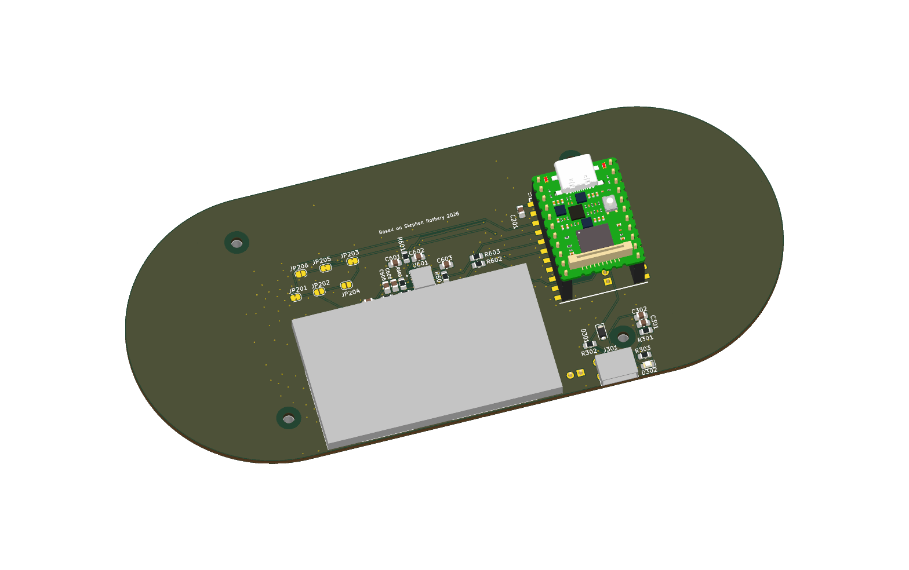

# ShieldSigner pill: 2.8-inch, eight-pin SPI LCD

This is the **0.0.6-dev pill carrier**: a larger plug-in display between the controls, the Luckfox Pico Mini underneath, and the SEC1210 smartcard reader on the back. It follows the eight-pin module interface in your existing Luckfox hardware design. The PCB is a **160 × 70 mm horizontal capsule**, with two semicircular ends and no rectangular display bay.


JLCPCB assembles **35 SMT pieces across 17 catalog lines**. Customer soldering is ordinary **2.54 mm headers**: 30 joints on the carrier, plus up to 30 on unheadered LCD/Luckfox modules. There is no customer LCD ribbon connection, fine-pitch connector, QFN or smartcard-contact soldering. The camera retains its normal Luckfox ribbon connection.

## Get the matching files

- [Complete JLCPCB prototype quote kit](https://www.shieldsigner.dev/files/shieldsigner-modular-order.zip): Gerber ZIP, BOM, CPL, population and customer-parts list.
- [Full schematic PDF](https://www.shieldsigner.dev/files/shieldsigner-modular-schematic.pdf).
- [Portable KiCad project and local libraries/models](https://www.shieldsigner.dev/files/shieldsigner-modular-kicad.zip).
- [Customer assembly and first-power steps](MODULAR-ASSEMBLY.md), [readable SMT BOM](../variants/lcd-module-2.8/manufacturing/BOM.md), [manufacturing notes](../variants/lcd-module-2.8/manufacturing/README.md).
- [Complete STEP assembly](https://www.shieldsigner.dev/files/shieldsigner-modular-assembly.step), [GLB assembly](https://www.shieldsigner.dev/files/shieldsigner-modular-assembly.glb), [front drawing](../variants/lcd-module-2.8/pcb-top.svg), [back drawing](../variants/lcd-module-2.8/pcb-bottom.svg).
- [Native results](../variants/lcd-module-2.8/check-results.json), [footprint/model results](../variants/lcd-module-2.8/mechanical-check-results.json), [quote readiness](../variants/lcd-module-2.8/manufacturing/readiness.json).

These are matched **prototype quotation files**. Native ERC, DRC, connectivity and schematic parity pass with **zero exclusions**. Physical module fit, powered bring-up, assembler rotation/DFM approval and enclosure qualification remain first-article work. The previous 0.0.3-dev Pico-format bay and the separate standard FPC carrier use different manufacturing files; do not mix them with this kit.

## The design reference

Your [existing Luckfox hardware](https://github.com/lightningspore/seedsigner-luckfox-pico/tree/d1a703c240a38b826052e9eb993669f774000dfe/hardware-kicad) establishes a single eight-pin ST7789 connection. The dev-v1 board has two ordinary 1×8 headers with identical wiring. The shipit board uses the custom [ST7789_LCD_MOD1 footprint](https://github.com/lightningspore/seedsigner-luckfox-pico/blob/d1a703c240a38b826052e9eb993669f774000dfe/hardware-kicad/libraries/seedsigner-luckfox.pretty/ST7789_LCD_MOD1.kicad_mod).

This revision keeps its **BL, RST, DC, CS, CLK, MOSI, GND, 3V3 carrier numbering**, header pitch, module-based construction and controls around the display. It retains the ShieldSigner smartcard circuitry and pill silhouette. The old reference's 58.25 × 35.3 mm module outline and mounting holes are not reused for a larger panel. Its C190820 BOM entry identifies an eight-position header, not a retail LCD.

## Which display to buy

The selected module is **HOTHMI HTM-TFT028A16-SPI, no-touch version**: an assembled 2.8-inch, 240×320 ST7789V SPI board. Use [the manufacturer's product listing](https://www.hothmi.com/product/2-8-inch-display-high-brightness-st7789-spi/) and the [retained manufacturer specification](../reference/pdfs/HOTHMI-HTM-TFT028A16-SPI.pdf), especially pages 5–6. The UI uses the screen in landscape, 320×240; firmware initialization and rotation still need hardware verification.

Use its **J1 eight-position 2.54 mm row**, with a downward-facing male header into the carrier's female socket. The module also has a separate **2 mm J2 connector**; that is not the carrier connection. Product photographs show J1 solder lands, so buy the correct preheadered option or fit eight ordinary pins yourself. Confirm the purchased revision matches the drawing before soldering. Do not substitute a Pico-format board, a bare panel, an arbitrary eight-pin module, or a touch variant with different dimensions.

The drawing specifies **88 × 53.3 mm**, mounting centers **82.5 × 47.8 mm**, and four 3 mm holes. It depicts the PCB/front/rear stack as 1.6/4.1/5.2 mm; the product prose also gives 7.7 mm total while the product summary gives 10.9 mm. Our envelope reserves the larger **10.9 mm** stack and 12 mm between carrier and module PCB back. Confirm actual connector/body heights on the first module.

## Exact connector wiring

**Carrier pad numbers run opposite the manufacturer's J1 numbering.** Pad 1 is the carrier's square pad, marked BL. Match signals and the orientation drawing, not equal pin numbers.

| Carrier J701 | Signal | Module J1 | Carrier connection |
|---:|---|---:|---|
| 1 | BL | 8 / BL_E | RPI_BACKLIGHT; always on through JP201 by default |
| 2 | RST | 7 / RES | LCD_RST; Luckfox pin 9 |
| 3 | DC | 6 / D/C | LCD_DC; Luckfox pin 10 |
| 4 | CS | 5 / CS | RPI_SPI_CS; default jumper path to Luckfox pin 6 |
| 5 | CLK | 4 / SCL | LCD_SCLK; Luckfox pin 7 |
| 6 | MOSI | 3 / SDA | LCD_MOSI; Luckfox pin 8 |
| 7 | GND | 2 / GND | Common ground |
| 8 | 3V3 | 1 / VCC | **LCD_3V3**, dedicated regulator output |

Here SDA/SCL mean **SPI data and clock**, not I²C. No MISO is required for the write-only display. Keep JP201/JP203/JP205 closed and JP202/JP204/JP206 open. The default gives chip-select control and an always-on backlight. The inherited alternative jumpers share a host function; independent dimming is not promised by this wiring/firmware.

## Why the added power components are here

The LCD takes **3.3 V**, not the former Pico module's 5 V VSYS. **U701, AP2112K-3.3TRG1 (C51118)**, converts the board's regulated 5 V input to a separate LCD_3V3 rail. This avoids adding the display/backlight load to the Luckfox module's 3.3 V output. VIN and EN connect to +5V; GND connects to the plane; VOUT only supplies the LCD. The two regulator outputs are never joined.

**C701 and C702 are 10 µF, 25 V X5R, CL21A106KAYNNNE (C15850).** C701 decouples the LDO input; C702 stabilizes/decouples its output. The [Diodes datasheet](../reference/pdfs/Diodes-AP2112.pdf) calls for at least 1 µF; 10 µF nominal gives useful margin for capacitance loss under DC bias and load transients. Effective capacitance, startup and rail droop still need measurements. These reuse an existing carrier capacitor purchasing identity.

The AP2112's 600 mA rating is not a promise of 600 mA usable at 5→3.3 V in this layout. Dissipation is approximately **1.7 × LCD current** watts. At a planning load of 150 mA, that is 0.255 W; the datasheet's SOT25 184 °C/W figure implies roughly 47 °C junction rise under its test conditions. The LCD drawing's 120 mA figure describes the backlight, not a guaranteed maximum whole-module load. Measure total module current, regulator temperature and supply margin before treating the prototype as qualified.

The [power sensitivity calculation](../variants/lcd-module-2.8/manufacturing/lcd-power-budget.json), regenerated with `mise run variant:lcd:power-budget`, uses explicitly selected 5.25 V input, 3.1 V output and 40 °C local ambient to test margin. At 150 mA the regulator dissipates about 0.323 W; at 300 mA it dissipates about 0.645 W. Applying the datasheet's 184 °C/W value gives illustrative junction temperatures of roughly 99 °C and 159 °C respectively. These are **not predictions or measured bounds for this PCB**, and the latter case is already beyond the 150 °C absolute maximum in that simplified calculation. The 600 mA headline rating cannot establish safe 5-to-3.3 V operation here.

For the first article, capture the LCD supply minimum/maximum at startup and under display/camera/card activity against the module's **3.1–3.6 V operating range**. Measure whole-module current and U701 case temperature at recorded local ambient, both open and in the intended enclosure, until temperature stabilizes. Case temperature is not junction temperature; establish the thermal margin for the intended ambient before approving repeats. The LCD specification leaves total operating current unspecified, so its 120 mA typical backlight current cannot close this budget.

The module handles its own panel connection and backlight switching. Carrier J401/C401/Q401/R401–R410 and the old bare-panel schematic sheet are removed. The alternative J302 connector is also absent. There are no DNP mode-strap courtyard exceptions on this PCB.

## Smartcard and processor

The processor remains a **Luckfox Pico Mini**, socketed on two 1×11 strips. No Raspberry Pi Pico CPU or Pico-format LCD connector is used. The existing UART/SEC1210/PV-UR2 smartcard path, decoupling and eight physical buttons are retained.

J601 is the **Amphenol 7312P0225A13LF full-size contact smartcard socket**. A compatible SIM-size card requires a full-size adapter; this is not a second independently fitted SIM socket. See [supported cards and application differences](SMARTCARDS.md). JLCPCB handles the socket, USB-C contacts and SEC1210 QFN.

## Mechanical and 3D evidence

Four M2.5 supports use manufacturer-drawn hole centers. **12 mm female-female spacers**, eight M2.5×4 screws and suitable washers support the display rather than relying on connector friction. Both PCB sides reserve 6 mm diameter hardware areas. The power-input parts move clear of the lower-left support. Ground stitching joins the display/regulator return copper to the back plane.

The modeled 8.5 mm female socket, 2.54 mm male insulator and 6 mm posts give about **5.04 mm insertion** with the module back 12 mm above the carrier. The module's rear connector has 6.8 mm nominal clearance. The Luckfox retains its separate socket stack and outward-facing microSD. The screen sits higher than the 2.5 mm switch actuators, so an enclosure needs suitable button plungers and a new camera/card opening layout.

There are **19 portable STEP models** with recorded sources and hashes. Supplier/upstream models represent the Luckfox, switches, USB, bridge and regulator. **The LCD, card socket and threadless supports are clearly identified dimensional envelopes**, not detailed manufacturer STEP files. The LCD envelope is regenerated from the saved drawing by `scripts/model-pill-display.py`. Native checks verify reviewed solder lands, the eight-pin interface, capsule edges, mounting centers and module/button separation. Physical tolerances and complete enclosure fit remain untested.



## Reproduce the design

```sh
git lfs pull
mise run variant:lcd:open
mise run variant:lcd:check
mise run variant:lcd:models
mise run variant:lcd:fab
mise run variant:lcd:review
mise run variant:lcd:package
```

The native KiCad project is authoritative. The experimental tscircuit port and standard carrier remain separate. The modular kit has its own BOM, native placement export and shared Gerber/drill/CPL datum. See [how the site is generated and deployed](WEBSITE.md).

Revision **0.0.6-dev** uses shared-supplier C&K switches and GCT USB4125-GF-A-0190 with revised native lands. Use matched revision files and the measured-height button setup in [self-assembly](SELF-ASSEMBLY.md). Physical first-article fit and powered bring-up remain pending.

## Power-entry revision 0.0.6-dev

USB-C remains a power-only input with separate 5.1 kΩ CC pull-downs. J301 is now GCT **USB4125-GF-A-0190 / C5246813**, retaining the reviewed land pattern with 1.9 mm shell stakes. Optional **J302** adds a standard 1×2, 2.54 mm header: square pad 1 = +5 V, pad 2 = GND. Both inputs share the same rail; use only one regulated 5 V source at a time. See the [assembly guide](MODULAR-ASSEMBLY.md#alternative-5-v-power-header-006-dev). The HOTHMI interface, display mounts and button positions are unchanged.
