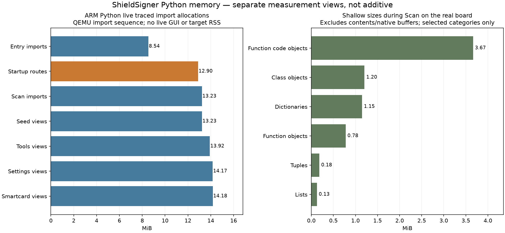

# Memory and threads on the Luckfox Mini

ShieldSigner runs on a single-core Luckfox Pico Mini with 64 MiB of physical RAM. The app, camera buffers and image processing compete for that small budget. The current development image uses deferred imports, bounded frame queues and compressed RAM swap to keep camera scanning responsive.

Measurements below were taken on 29 October 2026 with the 0.0.39-dev image and a 240×240 ST7789 display. They describe this configuration, not every Luckfox model or future release.

## Where the physical RAM goes

Linux reports about 45 MiB in `MemTotal`. Another 12 MiB is reserved for camera DMA; roughly 7 MiB is in other kernel/platform reservations that have not been fully attributed. With the app and camera stopped, an earlier measurement found about 32 MiB available.

`MemAvailable` includes memory Linux expects it can reclaim, such as file cache. It is more useful than `MemFree` for estimating headroom. Resident PSS attributes physical pages to processes while apportioning shared pages; RSS counts shared pages in each process. Virtual address space is not physical RAM consumption.

## Python memory during Scan

A snapshot of the normal app after boot, menu navigation and entering Scan measured:

| Process | Threads | Resident PSS | Logical swapped pages |
|---|---:|---:|---:|
| Python app | 7 | 13.7 MiB | 13.8 MiB |
| Rust camera | 5 | 8.9 MiB | 0.08 MiB |
| ZXing QR worker | 1 | 0.67 MiB | 0 |

These sequential reads fluctuate. The numbers are a snapshot, not allocation limits or simultaneous high-water marks. Before Scan, Python had four threads and about 17.5 MiB resident PSS, with 10.9 MiB logically swapped. Resident memory can fall when Scan opens because Linux compresses less-used app pages to make room for the camera.

Python's process includes:

- The interpreter, imported module dictionaries, functions, classes and constants.
- App objects, screen state and Python-managed data.
- Pillow images, drawing canvases, fonts and caches.
- Received frame data and temporary image conversions.
- Thread stacks, allocator overhead and native libraries loaded into Python, including the Rust LCD extension.

The separate Rust camera and ZXing processes are outside Python's PSS. All seven Python threads share the same modules and heap; the app is not copied seven times. Python allocators may retain freed space for reuse, so releasing an object need not immediately reduce RSS. The later census below counts live objects and measures shallow sizes. It still does not assign every allocation to an owning feature; no complete-heap percentages are inferred.

## Imports and startup peaks

An import executes a module's top-level code, creates objects and recursively imports dependencies. Modules generally remain cached for the process lifetime. Optional background preloading now stays disabled in the small-RAM profile: screens load when needed, while required seed and encrypted-QR storage initialization still runs.

Scan also previously imported two SLIP39 destination screens from `seed_views`, pulling in a larger dependency graph immediately. Those original classes now resolve only when their SLIP39 branch is used. Features remain available; first entry can take longer, and imported modules are not automatically unloaded afterward. A separate test with wallet, smartcard and settings modules preloaded also passed, so successful scanning is not limited to an empty optional import graph. The memory saving attributable to imports alone has not been isolated.

One measured startup fix is independent of imports: verifying the roughly 8 MiB QR executable used to read the entire file into a temporary Python buffer. SHA-256 now streams 64 KiB chunks. On-board isolated peak RSS fell from 18,088 KiB to 10,076 KiB with the identical hash result, a 7.82 MiB transient saving. This verifies the expected executable; it is not memory required for decoding a QR and is not a steady-state saving.

## Threads and how they cooperate

During the measured Scan there were 13 application threads across three processes. Other OS services and kernel threads are not included.

| Python thread | Work |
|---|---|
| Main app | Navigation, QR requests and decoded-result handling |
| MicroSD monitor | Waits for insert/remove notifications |
| Wipe timer | Checks the configured inactivity wipe policy |
| RNG monitor | Periodically samples the system RNG |
| Camera reader | Receives frames from the Rust camera process |
| Camera log drainer | Drains the child process pipe so logging cannot block capture |
| Live preview | Prepares images and calls the LCD driver |

The camera process has five threads for control/AE/AWB/ISP parameters, image capture, ISP statistics, raw-buffer bridging and frame transport. ZXing has one worker thread. Loading screens and notifications may temporarily change counts. These roles come from the implementation; Linux's thread names do not individually identify every Python class.

```text
Camera hardware and ISP
        |
Rust camera process (5 threads)
        | local socket
Python app (7 threads during Scan)
        |-- main Scan loop --> ZXing process (1 thread) --> decoded result
        |-- live preview --> Rust LCD extension --> SPI --> display
```

The board exposes one CPU core. Threads let waiting operations overlap: while SPI, camera input or a socket is waiting, another runnable thread can execute. They do not create 13-way CPU execution. Camera/ISP hardware can operate independently of CPU scheduling.

Python's GIL generally permits one thread to execute Python code at a time. The Rust LCD extension releases it during conversion and SPI waits. The camera and ZXing run in separate processes outside Python's GIL, while still sharing the same single CPU. Each thread needs its own stack and kernel bookkeeping, but stack address-space reservations are not necessarily fully resident.

## LCD pixel buffers

The Rust LCD extension runs inside Python and creates no dedicated process or thread. For the current 240×240 profile:

| Allocation | Pixel bytes | Lifetime |
|---|---:|---|
| Rust RGB565 output buffer | 115,200 bytes / 112.5 KiB | Reused for successive frames |
| Packed Python RGB input | 172,800 bytes / 168.75 KiB | Temporary for each display update |

The shim calls `image.convert('RGB').tobytes()` and Rust converts those bytes into its reusable output buffer. Pillow canvases, converted image storage, fonts, object overhead, mapped extension code and kernel SPI buffers add to those figures. Pillow's internal RGB storage can exceed the three-byte-per-pixel packed payload. The table is an exact pixel-buffer calculation, not a measurement of the LCD's complete memory cost. The display controller's own screen memory is separate from Luckfox RAM.

A 640×480 camera frame is about 450 KiB in NV12 or 900 KiB as packed RGB. QR decoding uses the full-resolution grayscale plane while only the preview is reduced for display. Bounded queues and latest-frame delivery prevent a slow preview or decoder from accumulating an unbounded history of frames.

## Compressed RAM swap

Zram compresses less-used pages in RAM; it does not write swap to the microSD. This profile provides a 16 MiB logical swap device with an 8 MiB compressed-allocation limit and LZO compression. Logical swapped bytes must not be added to physical RAM consumption at their uncompressed size.

In the normal Scan snapshot, zram's allocator occupied about 7.1 MiB of actual RAM and the logical swap device was nearly full. Available RAM was about 8.2 MiB. The same snapshot showed 10.6 MiB camera DMA, 4.4 MiB unreclaimable kernel slab, 0.49 MiB system-wide kernel stacks and 0.38 MiB system-wide page tables. These are different accounting views, not a disjoint pie chart to sum with process PSS and available cache.

## Measured continuous operation


The exact packaged app/camera/QR/LCD files passed a 20-minute physical-board run from a read-only compressed-rootfs mount: 17,811 frames, 5,929 renders, 7,042 QR calls, zero errors/reconnects, exit status 0 and clean owner/DMA teardown. Across 871 steady camera-phase samples, available RAM was 7.79–11.70 MiB, median 10.36 MiB. Median PSS was 14.73 MiB app, 5.69 MiB camera and 0.52 MiB QR worker; compressed-swap allocation was 6.73–6.93 MiB.

The soak retained the existing kernel/Python/zram setup. The later normal-app snapshot above is from the newly booted image and a different menu/import history, so its memory numbers differ. A completed soak does not establish optical QR success, physical Back navigation or every boot scenario.

[Download the soak result](../reverse-engineering/rkaiq/memory/gui-packed-image-1200-result.json). The detailed diagnostic chronology and reproduction commands are in [the repository memory report](https://github.com/lightningspore/shieldsigner-dev/blob/main/docs/CAMERA-MEMORY.md).


## Deeper Python measurements



A controlled import run used the image's actual 32-bit ARM Python 3.12.10 under QEMU on the builder. That gives the ARM Python allocation layout with room for snapshots; it is not a board-RAM or live-GUI measurement. Sequential imports share dependencies, so costs depend on their order.

| Import stage | Live traced allocations | Loaded modules |
|---|---:|---:|
| Entry imports and integration setup | 8.54 MiB | 358 |
| Controller startup routes | 12.90 MiB | 505 |
| Scan imports | 13.23 MiB | 507 |
| Seed views afterward | 13.23 MiB | 507 |
| Tools afterward | 13.92 MiB | 522 |
| Settings afterward | 14.17 MiB | 525 |

**Startup still eagerly imports the smartcard menu.** The reviewed `Controller.start()` imports `ToolsSmartcardMenuView` before showing Home. The startup-route group adds about 4.36 MiB in this run. Importing seed views afterward adds almost nothing because their dependency graph is already present. Disabling the background preload and deferring the Scan SLIP39 edge does not remove this separate startup import. Moving that import into the branch that uses the menu is an optimization opportunity, not an implemented saving.

Much of the trace is attributed to Python's import machinery because that is where loaded code objects/constants are allocated. For example, entry imports attributed 4.83 MiB to `importlib._bootstrap_external`; this is allocation-site attribution, not evidence of a loader leak or proof that removing importlib would save that memory. Other entry allocation sites included dataclasses (0.33 MiB), pycparser's parser table (0.27 MiB), enum (0.18 MiB) and typing (0.10 MiB). Import-time paths do not establish which feature owns every referenced object.

### Live objects on the real board

A separate, lighter census ran in the actual GUI without tracemalloc. It added one monitor thread and exported only type names, counts and numeric sizes. During Scan it found:

| Object category | Count | Shallow size |
|---|---:|---:|
| Unique code objects referenced by functions | 9,698 | 3.67 MiB |
| Class objects | 1,715 | 1.20 MiB |
| Dictionaries | 4,967 | 1.15 MiB |
| Function objects | 10,198 | 0.78 MiB |
| Tuples | 5,992 | 0.18 MiB |
| Lists | 1,596 | 0.13 MiB |

These include the standard library and dependencies, not just application-defined objects. Shallow sizes exclude referenced contents and are not a complete heap decomposition. The GC census misses many strings/bytes and native allocations. The code-object view and traced-allocation view overlap and must not be added.

There were 41,038 GC-tracked objects at the startup screen, 42,145 during Scan and 42,040 after returning to the menu. The post-Scan count being close to the active count does not prove camera buffers leaked: code, classes, fonts and caches remain imported. The camera/QR processes exited and camera DMA returned to zero after the user pressed Back.

The census saw 4 Pillow image wrappers and 2 font wrappers at startup, 10 images and 14 fonts in Scan, and 11 images and 14 fonts back at the menu. These are wrapper counts, not pixel/font-cache byte counts; the menu itself also creates images. Image dimensions, pixel modes and native font allocation require separate instrumentation before assigning a byte total.

### Why measuring changes resident memory

Walking objects touches pages. During the Scan census, process PSS rose from 16.18 to 21.24 MiB while logical swap fell from 9.97 to 5.20 MiB. Much of that change is cold pages being decompressed into RAM, not new retained application data. The census also creates temporary reference lists and counters. Compare the views and profiler overhead rather than interpreting PSS movement alone as a leak.

Full on-target tracemalloc snapshots made the Mini unresponsive and required a reboot. In the server-side import run, tracing metadata alone grew to about 5.2 MiB before snapshot temporaries. The full-snapshot tool now refuses low-memory targets. The board was restored to its normal app; detailed import tracing remains off-board.

[Measurement summary](../reverse-engineering/rkaiq/memory/python-deep-2026-10-29/summary.json) contains the two separately scoped experiments. Helper sources live in `firmware/bench-profiles/python-object-census.py` and `python-import-memory-profile.py`; the full snapshot helper is not a Mini profiling recipe.

## Deferred smartcard startup import

The guarded small-RAM integration now defers the optional smartcard dependency graph previously imported at entry to `Controller.start()`. The smartcard-menu cache-clear check still verifies the original view class identity; home wipe, signing, entropy and mandatory storage initialization remain unchanged.

A fresh-process comparison using packed ARM Python under QEMU measured 13,362,142 → 8,965,308 traced live bytes at startup-route imports (**4.19 MiB lower**) and 13,707,170 → 9,177,171 after Scan imports (**4.32 MiB lower**). Both stages loaded 144 fewer modules. Opening seed views loads part of the graph; Tools loads almost all of it. The allocation saving is temporary until those features are used.

These are controlled import-stage measurements, not target PSS/RSS or full GUI startup results. Native allocations and profiling overhead differ from ordinary app memory. The real-board comparison remains pending. Source hashes, stages and limits are in `reverse-engineering/rkaiq/frontend/startup-import-comparison-2026-10-29.json`.

## Matched frontend comparison on the Mini

One 90-second real-Scan diagnostic run per backend used the same current startup policy, camera owner, native ZXing, Rust LCD, Small-RAM/zram and code-lock settings. Python ran first. The 30–75-second steady windows gave:

| Metric | Python frontend | Rust frontend |
|---|---:|---:|
| App CPU, percent of one core | 43.3% | 28.3% |
| Render calls/sec | 4.86 | 5.58 |
| Camera frames/sec | 14.95 | 14.97 |
| QR calls/sec | 5.91 | 5.99 |
| Median app PSS | 15,250 KiB | 15,736 KiB |
| Median app SwapPss | 5,708 KiB | 7,080 KiB |
| Median available RAM | 8,746 KiB | 10,052 KiB |
| Minimum available RAM | 6,964 KiB | 9,668 KiB |
| App threads including benchmark helpers | 9 | 10 |

App CPU was about 34% lower and rendering about 15% faster in this pair. Both runs had zero reader, renderer and QR errors/reconnects and clean timed owner cleanup; the final DMA count was zero. RAM results are mixed: the reusable native pool/thread has a cost, app PSS/swap were higher, and zram/page residency changed. This is not evidence of a net app-memory reduction. The extra native receiver thread remains in addition to the Python owner coordinator.

CPU derives from target `/proc/PID/stat` counters with measured `SC_CLK_TCK=100`. The host sampler adds no on-board Python process. The benchmark adds telemetry/watchdog threads and starts Scan directly; its duration termination is separate from the successful real Back/cancel tests. Scene, order, cache/zram residency and CPU frequency/temperature were not controlled beyond using the same board/settings. No optical QR or signing workload was presented. Source hashes, sample hashes and scoped measurements: `reverse-engineering/rkaiq/frontend/matched-gui-performance-2026-10-29.json`.
